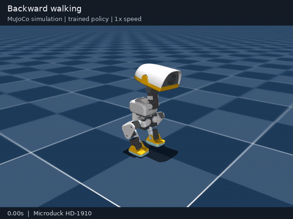

# Microduck-HD-1910

## 已训练动作与统一仿真控制

完整模型、运行脚本、机器人资源及训练历程见 [simple_movements](simple_movements/README.md)。

```bash
cd simple_movements
bash setup.sh
bash run.sh
```

## 动作演示（MuJoCo 仿真）

以下五段由仓库中的最终模型实际驱动物理仿真录制，均为原速播放：速度420轮、坐站120轮、前滚翻380轮。每段独立运行，包含动作及停止/恢复过程；不是实机拍摄。GIF用于直接预览，MP4保留640×480、25fps原视频。

| 行走 | 转弯 |
| --- | --- |
| **行走**<br><br>[MP4 原视频](simple_movements/media/videos/walking.mp4) | **转弯**<br><br>[MP4 原视频](simple_movements/media/videos/turning.mp4) |
| 倒退 | 坐下与起立 |
| **倒退**<br><br>[MP4 原视频](simple_movements/media/videos/backward.mp4) | **坐下与起立**<br><br>[MP4 原视频](simple_movements/media/videos/sitstand.mp4) |
| 前滚翻与起身 | |
| **前滚翻与起身**<br><br>[MP4 原视频](simple_movements/media/videos/roulade.mp4) | |

[录制方法与验证记录](simple_movements/media/README.md) · [完整训练与实现历程](simple_movements/README.md)
