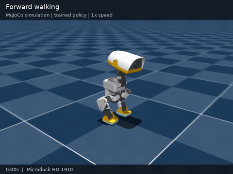
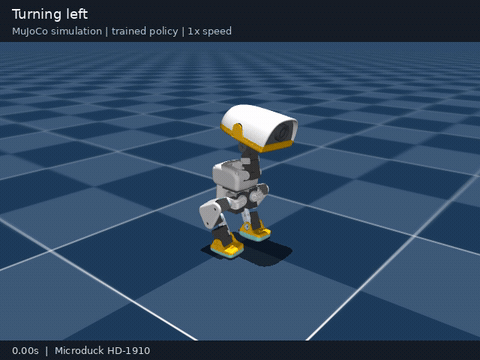
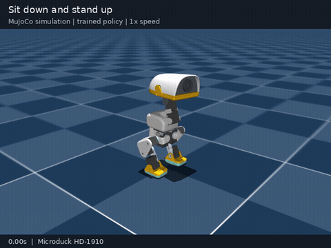
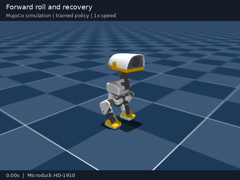

# Microduck-HD-1910

## 已训练动作与统一仿真控制

完整模型、运行脚本、机器人资源及训练历程见 [simple_movements](simple_movements/README.md)。

```bash
cd simple_movements
bash setup.sh
bash run.sh
```

## 动作演示（MuJoCo 仿真）

以下展示最终模型的行走、转弯、倒退、坐下起立和前滚翻能力。画面为 MuJoCo 仿真，GIF 下方可查看 MP4 原视频。

| 行走 | 转弯 |
| --- | --- |
| **行走**<br><br>[MP4 原视频](simple_movements/media/videos/walking.mp4) | **转弯**<br><br>[MP4 原视频](simple_movements/media/videos/turning.mp4) |
| 倒退 | 坐下与起立 |
| **倒退**<br><br>[MP4 原视频](simple_movements/media/videos/backward.mp4) | **坐下与起立**<br><br>[MP4 原视频](simple_movements/media/videos/sitstand.mp4) |
| 前滚翻与起身 | |
| **前滚翻与起身**<br><br>[MP4 原视频](simple_movements/media/videos/roulade.mp4) | |

[完整训练与实现历程](simple_movements/README.md)

## 进阶动作

右脚踢球、嘴部夹取和单脚站立的策略权重、MuJoCo 运行入口与演示视频见 [advanced_movements](advanced_movements/README.md)。

```bash
bash advanced_movements/run.sh
```
