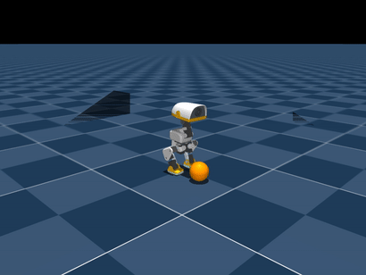
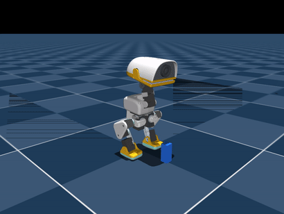
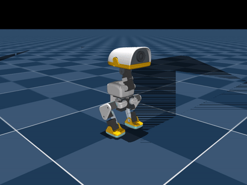

# Microduck HD-1910 进阶动作

右脚踢球、嘴部夹取和单脚站立共用一个 MuJoCo 演示入口。每个动作使用独立的 SuperMimic 策略，并从对应场景的初始状态开始。

| 右脚踢球 | 嘴部夹取 | 单脚站立 |
| --- | --- | --- |
|  |  |  |
| [MP4 原视频](media/videos/kick.mp4) | [MP4 原视频](media/videos/grasp.mp4) | [MP4 原视频](media/videos/flamingo.mp4) |

## 运行发布版

从仓库根目录执行，依赖复用 [simple_movements](../simple_movements/README.md) 锁定的 Python 环境。

```bash
(cd simple_movements && uv sync --frozen)
bash advanced_movements/run.sh
```

在窗口中按 **1** 踢球、**2** 夹取、**3** 单脚站立，按 **R** 重播，按 **Q** 或 **Esc** 退出。单脚站立展示右脚支撑、左脚抬起、落脚恢复。夹取策略控制身体，嘴部控制器负责开合时序和扭矩保护。

默认使用 CPU。无窗口运行三项动作，或用 `--skill` 选择单项。

```bash
MUJOCO_GL=egl bash advanced_movements/run.sh --headless
MUJOCO_GL=egl bash advanced_movements/run.sh --headless --skill grasp
```

## 模型与控制输入

| 动作 | 策略权重 | 控制内容 |
| --- | --- | --- |
| 右脚踢球 | [kick_0420.pt](models/kick_0420.pt) | 准备、踢球和恢复 |
| 嘴部夹取 | [grasp_0120.pt](models/grasp_0120.pt) | 低头夹取并起身抬升 |
| 单脚站立 | [flamingo_0290.pt](models/flamingo_0290.pt) | 主策略与落脚策略 |

三个 `.pt` 都是 PyTorch 策略 `state_dict`，仅包含推理张量，可用 `torch.load(path, weights_only=True)` 读取。导出的张量逐项与原模型核对。文件哈希与大小见 [模型清单](models/manifest.json)。`configs/` 与 `references/` 提供控制配置、策略目标轨迹及夹取初始状态。机器人资源及其许可证见 [simple_movements/licenses](../simple_movements/licenses/NOTICE.md)。

## 1. 三项动作的共同训练流程

三项动作都在带 HD-1910 舵机模型、被动齿隙和 20 ms 指令延迟的 MuJoCo 环境中训练。控制频率为 50 Hz，物理频率为 200 Hz。每项任务独立录制教师参考、构建回放并训练策略。

1. **闭环录制教师。** 在目标物理环境执行教师策略，记录机器人与任务物体的状态、实际动作、接触信息及执行器历史。用连续转移训练世界模型，用参考轨迹给学生策略提供未来目标。
2. **预热世界模型、actor 和 critic。** 先用真实物理转移拟合世界模型，再用行为克隆（BC）初始化 actor，用真实回放的回报预热 critic。踢球和夹取分别采用 5,000、2,000、1,000 次更新。单脚站立使用通过闭环抬脚验收的限幅纠偏 BC，再预热世界模型和 critic。
3. **交替采样和联合更新。** 正式配置每轮从 64 个环境各采集 50 步，共 3,200 条真实转移。世界模型按 8 步窗口学习，actor 优化 32 步想象回报，critic 使用 GAE 训练。完整回合可跨多个采集轮次。
4. **用完整闭环动作选权重。** 踢球看真实触球、球的运动和末段站稳，夹取看接触后的合格抬升，单脚站立检查承重、净空、保持和落脚恢复。下文的历史评估与最后的发布版 CPU 复测来自不同运行。

## 2. 右脚踢球 → 收腿恢复

最终参考共 4 秒，含 0.5 秒站立准备、0.5 秒踢球和 3 秒恢复。使用同一物理场景重新录制教师，在 64,000 条真实物理转移上训练世界模型，并用教师动作做 BC。联合训练中的随机复位混合均匀采样、当前困难、困难分箱和历史困难四组。

| 训练中遇到的问题 | 实施方案 | 实施后观察到的效果 |
| --- | --- | --- |
| 旧参考约第 5 帧球已运动，从中途复位容易遇到滚动球，漏踢统计混入延续片段 | 在同一物理环境真实执行 0.5 秒准备期后重录参考。新起踢筛选初始球速低于 0.05 m/s 且无脚球接触，把滚动延续单独计数，并将漏踢写入困难记忆 | 准备期短测的球水平漂移为 0，明显运动推迟至第 29～30 帧。v4 最佳 BC 右脚触球 14/20，完整成功 4/20。随后联合训练的五次定期检查仍为 0/20 |
| 身体贴近参考时仍可能漏踢，球也可能向侧面滚走 | 困难评分改为身体 70%、球 30%，球位置和速度奖励各提高至 0.25。v5 加入有界侧移惩罚，世界模型的球 XYZ 位置损失权重从 3 提至 12，重新采集动力学并预热 | v5 恢复触球并获得完整成功。两版选定的预热世界模型中，32 步球位置 RMSE 从 74.40 mm 降到 45.33 mm。该比较反映整套修改后的结果 |
| 踢到球后仍会晃动，继续联合更新会破坏末段站稳 | 增加独立的末 1 秒连续稳定检查，并在固定场景比较多个检查点。结合动作观察与末段表现选用第 420 轮 | 第 410 轮完整成功 14/20、末段站稳 18/20。第 420 轮右脚触球 16/20、站稳 20/20、完整成功 11/20。第 450 轮仍有 15/20 右脚触球，完整成功降至 0/20 |

固定场景的完整成功还要求全程存活、没有左脚触球、球前向峰值速度大于 0.3 m/s、最终前进大于 0.15 m、绝对侧移小于 0.15 m。第 410 与 450 轮同组 CPU 补测都能触球，但后者末段平均线速度由约 0.011 升至 0.040 m/s，相邻动作变化也增大。末段稳定失败与困难采样的直接联动仍待验证。

## 3. 嘴部夹取 → 直接起身

训练从闭环夹取教师和站立教师开始。在 HD-1910 场景中加入可动嘴部、接触几何和 12 g、2 × 2 × 5 cm 的长方体，再分别采集干净教师回放与带探索噪声的动力学回放。状态布局扩至 324 维，记录物体位姿和速度、上下嘴接触历史、扭矩保护状态及执行器延迟。学生 actor 控制 14 个身体关节，嘴部开合及扭矩保护由确定性控制器执行。

| 训练中遇到的问题 | 实施方案 | 实施后观察到的效果 |
| --- | --- | --- |
| 低头靠近物体无法保证夹住，碰撞弹起也可能抬高物体 | 按回合记录上下嘴接触，只有两侧都曾接触后的抬升才合格，且须严格超过 16 cm。抬升进度按历史峰值累计最多 +36，首次成功 +54，回合失败 −18。困难评分纳入 30% 物体项，世界模型物体位置损失权重设为 12 | 接触前的高点与重复升降被排除在成功和重复进度奖励之外。后续评估按合格峰值抬升统计 |
| 收嘴接触后扭矩升高，持续加力会改变夹持状态 | 嘴部目标限制为 5°～35°，每 5 ms 检查扭矩。以空嘴标定为基准，达到 1.8 倍时锁存目标，闭合输出降至 1.5 倍保持 | 探针的目标角均在范围内。实测最低角仍约 3.70°～4.20°，实测角度边界尚未通过 |
| 早期教师夹起后再次低头，第 40 轮学生也复现这段动作 | 合格抬升达到 4 cm 即切到站立教师，最迟 1.84 秒切换，并清空上一教师动作反馈。重新录制直接起身参考与回放 | 256 个干净教师回合中 97 个成功，所选参考峰值约 18.61 cm。原先明显的二次低头减少，部分轨迹仍有短时回落 |
| 首次独立评估缺少状态布局，长训中也曾遇到显存不足 | 在评估环境先调用 `state()` 初始化并核对 schema，再加载参考。历史显存中断后从第 20 轮恢复，将在线回放上限降为 32,768 条 | 修复后独立环境可以完成评估。短流程覆盖三段预热、想象更新及 3,200 条在线采样 |

历史一次直接起身训练的第 120 轮成功 20/20，平均合格峰值 20.53 cm，随后第 130、140 轮均降至 0/20。发布权重来自随后重新训练的一次运行，在第 10～160 轮留存的定期评估中，第 120 轮表现最佳，成功 19/20，19/20 跑完整回合，平均合格峰值 18.78 cm。该指标衡量回合中曾达到的夹取抬升高度，末段持续持物需另行评估。

## 4. 单脚站立 → 落脚恢复

双侧参考均由 Flamingo Cycle 教师在本地 HD-1910 场景闭环录制。每条参考共 17 秒，包含 2 秒站立准备、2 秒抬脚、10 秒保持和 3 秒落脚恢复。发布演示使用右脚支撑、左脚抬起。完整验收从 HOME 开始，要求保持期间抬起脚净空至少 5 cm，并在落脚后检查双脚站稳。

| 训练中遇到的问题 | 实施方案 | 实施后观察到的效果 |
| --- | --- | --- |
| 学生离开教师参考后缺少纠偏示范，旧动作范围也会导致起站跌倒 | 在学生实际到达的状态查询教师并做闭环纠偏 BC。真实执行、BC 与想象统一使用 HOME 偏移 ±π/2 rad 和 0.02 rad 关节限位裕量。按相同规则重采真实回放 | 限幅 BC 通过实际抬脚验收。重新采得 160 回合、69,708 条物理转移，涵盖速度、倾角和组合扰动 |
| 从 HOME 开始的片段多，落脚样本覆盖不足；脚底接近地面时也可能未承重 | 回放复位保留 25% HOME，其余覆盖各阶段并恢复执行器历史；在线环境独立复位。站立阶段加入实测足底承重、capture point 支撑区和机身速度罚分，世界模型增加承重预测 | 训练能够采到后半段的失衡及恢复，并用足底受力监督站姿。历史第 250、280 轮已有保持满 10 秒的回合，完整成功仍为 0/20，主要失败集中在落脚 |
| 约 14 秒切换到落脚分支时目标角跳变，冻结整个 actor 后只校准世界模型和 critic 仍会跌倒 | 先统一物理与想象中的分支过渡和限速。随后冻结主策略，以 7,240 条成功纠偏样本单独训练落脚分支。最终从第 700 帧切换，混合 1 帧，每步目标变化上限为 0.12 rad | 修复后的学生右侧名义测试保持 10 秒、落脚后站稳 2.08 秒。右侧扰动试验成功 9/10，唯一失败发生在落脚分支介入前 |
| 新世界模型平均误差下降，32 步跌倒识别却只有 3/7 | 拒绝该候选并恢复此前通过验收的世界模型，保留修复后的 actor 与重新校准的 critic。验收加入多步姿态、位置、承重和跌倒识别 | 复审中 32 步跌倒识别为验证集 5/5、测试集 6/7，随后进入正式联合续训 |

正式续训第 290 轮右脚支撑完整成功 10/10，均保持 10 秒，末段连续站稳 1.86～2.20 秒。第 300、310、320 轮分别出现落脚跌倒、保持不足和起站跌倒，右侧完整成功均为 0/10。正式联合更新重新放开了纠偏时冻结的主策略，说明发布时应保留通过完整动作验收的第 290 轮及其落脚分支。

## 5. 发布权重的 CPU 仿真复测

| 动作 | 完整运行 | 单次发布版复测 |
| --- | ---: | --- |
| 右脚踢球 | 200 步 | 右脚触球，球向前移动 1.323 m |
| 嘴部夹取 | 250 步 | 夹取成功，合格峰值抬升 19.95 cm |
| 单脚站立 | 850 步 | 右脚支撑 10.00 秒，落脚后双脚连续站稳 2.04 秒 |

以上为 MuJoCo 仿真结果，实机表现尚未验证。
